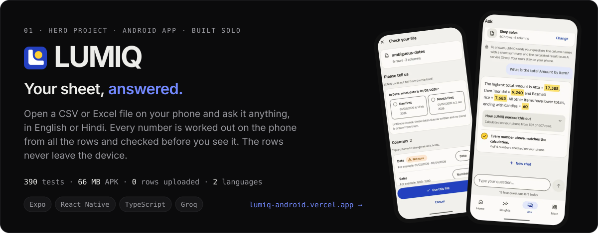
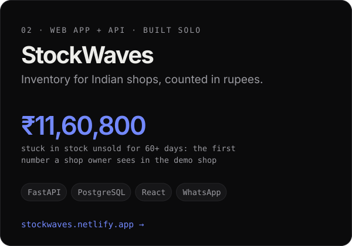
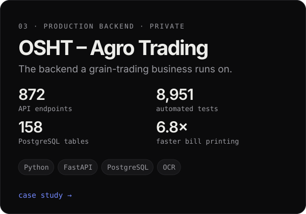
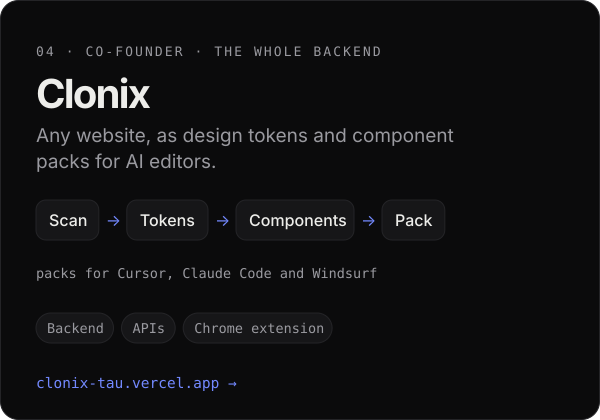
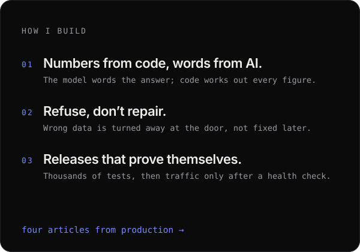

  <a href="https://saksham.sqaron.dev/"><b>Portfolio</b></a> &nbsp;·&nbsp;
  <a href="https://www.linkedin.com/in/saksham-srivastava-dev/"><b>LinkedIn</b></a> &nbsp;·&nbsp;
  <a href="https://saksham653.github.io/resume.pdf"><b>Résumé</b></a> &nbsp;·&nbsp;
  <a href="https://dev.to/saksham653"><b>Writing</b></a> &nbsp;·&nbsp;
  <a href="mailto:sakshamsrivastava7000@gmail.com"><b>Email</b></a>

I'm a backend, AI and full-stack engineer from Lucknow, India, and a co-founder of [Sqaron Technologies](https://sqaron.dev/).
I built the production backend that a multi-firm grain-trading business runs on every day, and I ship products of my own.
These are the ones I'd show you first.

Code: [LUMIQ](https://github.com/Saksham653/LUMIQ) · [StockWaves](https://github.com/Saksham653/inventory-management-system). OSHT and Clonix are private; their case studies are on [my site](https://saksham.sqaron.dev/work/).

### Notes from production

- [**Refuse, don’t repair**](https://saksham.sqaron.dev/writing/refuse-dont-repair/): building accounting books that can’t go wrong
- [**Releases that prove themselves**](https://saksham.sqaron.dev/writing/releases-that-prove-themselves/): zero-downtime deploys for a backend people use all day
- [**One warm browser**](https://saksham.sqaron.dev/writing/one-warm-browser/): printing a day’s bills, Hindi included, from a Python backend
- [**The model reads, the code decides**](https://saksham.sqaron.dev/writing/the-model-reads-the-code-decides/): AI document reading that can’t put a wrong number in the books

### Stack

**Backend** · Python, FastAPI, SQLAlchemy, PostgreSQL, background workers, Docker, Linux 
**AI** · LLM apps, LangChain, RAG, agents, OCR, Claude / OpenAI / Groq 
**Apps** · React Native, Expo, React, Next.js, TypeScript

Open to backend, AI and full-stack roles, and to freelance work · <a href="mailto:sakshamsrivastava7000@gmail.com">sakshamsrivastava7000@gmail.com</a>

