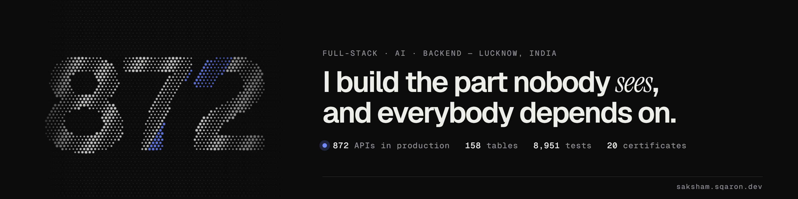

APIs, databases, books that balance, and AI that works on checked numbers —
plus the part people do see: web apps in Next.js and mobile apps in React Native.

[**🌐 saksham.sqaron.dev**](https://saksham.sqaron.dev) &nbsp;·&nbsp;
[**LinkedIn**](https://www.linkedin.com/in/saksham-srivastava-dev/) &nbsp;·&nbsp;
[**Résumé**](https://saksham.sqaron.dev/resume/) &nbsp;·&nbsp;
[**Email**](mailto:sakshamsrivastava7000@gmail.com)

`Co-founder, Sqaron Technologies` &nbsp; `OSHT backend · 872 APIs · 8,951 tests` &nbsp; `IBM Data Science & AI path`

---

## What I've built

| | |
|---|---|
| **[OSHT – Agro Trading](https://saksham.sqaron.dev/work/osht/)** · production backend | The backend and features behind a grain-trading business's Android, iOS and web apps: **872 API endpoints, 158 PostgreSQL tables, ~257,000 lines of Python, 8,951 tests**. Double-entry books that refuse unbalanced vouchers, workers that match every payment to its bill, OCR in, batch PDFs out, zero-downtime releases. *(private repo)* |
| **[Clonix](https://saksham.sqaron.dev/work/clonix/)** · co-founder, backend | A design-DNA engine that turns any website into design tokens and component packs for AI editors. |
| **[LUMIQ](https://github.com/Saksham653/LUMIQ)** · [live](https://lumiq-silk.vercel.app) | Talk to your data: upload a CSV, ask in plain English, get answers, charts and forecasts (Groq + Llama 3.3 70B, runs in the browser). |
| **[FlowCraft](https://github.com/Saksham653/Flow-Craft)** · [live](https://flow-craft-theta.vercel.app/) | A full SaaS that chains AI stages into content pipelines — auth, payments, credits. |
| **[StockWaves](https://github.com/Saksham653/inventory-management-system)** | Stock, sales and suppliers with analytics and an AI assistant (FastAPI, async PostgreSQL, JWT, Docker). |
| **[HR Agent Pro](https://github.com/Saksham653/hr-agent-pro)** · **[DriftWatch](https://github.com/Saksham653/ML-DRIFT-DETECTION---PERFORMANCE-MONITORING)** · **[SmartEdge Copilot](https://github.com/Saksham653/smartedge-copilot)** | Multi-agent LangChain, MLOps drift monitoring, and an LLM copilot with plugins. |

## How I work

Numbers come from code, words come from the model — never the other way round.
Wrong data is refused at the door, not repaired later. Thousands of tests before every release.

## Stack

**Backend** — Python · FastAPI · PostgreSQL · SQL · Docker · background workers · OCR
**Front end & mobile** — Next.js · React · TypeScript · Tailwind · Motion · WebGL · React Native · Expo
**AI** — LangChain · RAG · AI agents · Groq / OpenAI / Claude

**Open to full-stack, backend and AI roles, and to freelance projects** — [saksham.sqaron.dev](https://saksham.sqaron.dev)

